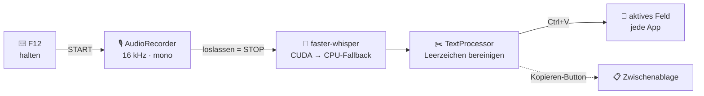
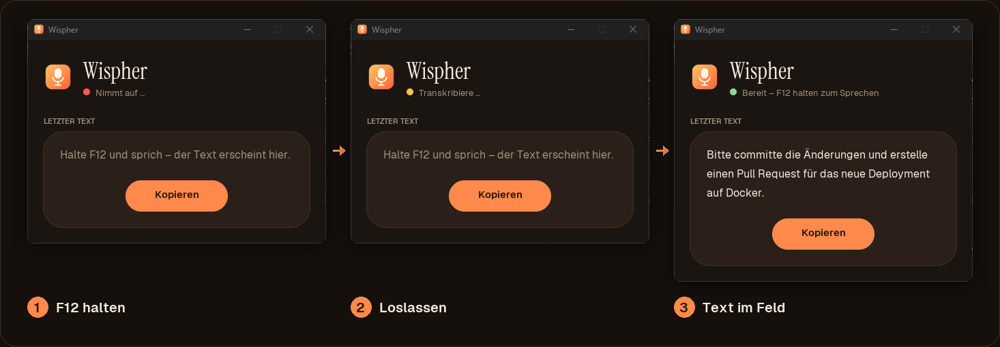

<p align="center"></p>

<p align="center">


<a href="LICENSE"></a>
</p>

<p align="center">
<a href="#schnellstart">Schnellstart</a> ·
<a href="#warum-wispher">Warum Wispher?</a> ·
<a href="#konfiguration-configyaml">Konfiguration</a> ·
<a href="#datenschutz--prüf-es-selbst">Datenschutz</a> ·
<a href="#lizenz">Lizenz</a>
</p>

# Wispher — Local Push-to-Talk Speech-to-Text

**F12 halten → sprechen → loslassen → der Text steht im aktiven Feld.**
100 % lokal. Keine Cloud. Kein API-Key. Kein Mikrofon-Bit, das dein Büro verlässt.

Wispher ist ein Windows-Tool für Push-to-Talk-Diktat. [faster-whisper](https://github.com/SYSTRAN/faster-whisper)
läuft lokal auf GPU (CUDA) oder CPU. Die Audio-Rohdaten liegen nur kurz im
`%TEMP%` und werden nach der Transkription gelöscht.

<p align="center"></p>

## Warum Wispher?

Du diktierst Prompts, Commit-Messages und Mails und willst dabei nicht die Hände von der Tastatur nehmen. Du willst auch keinen Dienst, der jedes Wort mithört.

| | **Wispher** | Windows-Diktat (`Win`+`H`) | Cloud-Diktierdienste |
|---|:---:|:---:|:---:|
| Audio bleibt auf dem Rechner | ✅ | ❌ Microsoft-Cloud | ❌ |
| Funktioniert offline | ✅ nach dem Modell-Download | ❌ | ❌ |
| Laufende Kosten | **0 €** | 0 € | meist Abo oder pro Minute |
| Konto / API-Key nötig | ❌ | Microsoft-Konto nicht nötig | ✅ |
| Push-to-Talk in **jeder** App | ✅ eine Taste, kein Fokuswechsel | ⚠️ Tastenkombi, Diktierleiste | je nach Anbieter |
| Fachbegriffe (`Docker`, `Pull Request`) | ✅ per `initial_prompt` einstellbar | ⚠️ nicht anpassbar | je nach Anbieter |
| Quellcode prüfbar | ✅ ca. 600 Zeilen Python | ❌ | ❌ |
| Einrichtung | ⚠️ Python, ca. 3 GB Modell | ✅ nichts zu tun | ✅ |

Wispher ist **nicht** das Richtige, wenn du nur ab und zu diktierst und keine Python-Umgebung willst. Dann reicht `Win`+`H`.

## So funktioniert's



Wispher läuft als Tray-Icon mit kleinem Fenster. Das Fenster zeigt den letzten
Text. Ein Klick auf **Kopieren** legt ihn in die Zwischenablage, falls er nicht
im Zielfeld gelandet ist.

<p align="center"></p>

## Schnellstart

**Voraussetzungen:** Windows 10/11, Python 3.10+, ein Mikrofon. Eine NVIDIA-GPU ist optional.

```powershell
git clone https://github.com/guschi18/wispher.git
cd wispher
python -m venv .venv ; .venv\Scripts\activate
pip install -r requirements.txt
python wispher_app.py
```

1. **Warten**, bis der Status im Fenster auf „Bereit" springt. Beim ersten Start lädt faster-whisper das Modell (`large-v3` ≈ 3 GB) einmalig von Hugging Face.
2. **Cursor** in ein beliebiges Textfeld setzen.
3. **F12 halten**, sprechen, loslassen. Fertig.

Das Fenster schließen (X) schickt Wispher in den Tray. Beenden: Tray-Icon → Rechtsklick → **Beenden**.

### Mit NVIDIA-GPU (empfohlen, deutlich schneller)

```powershell
pip install nvidia-cublas-cu12 nvidia-cudnn-cu12
```

Ohne diese Pakete fällt Wispher automatisch auf die CPU zurück (siehe `wispher.log`). Mit CPU empfiehlt sich `model: small` und `use_gpu: false` in der `config.yaml`.

### Eigene EXE bauen

```powershell
build.bat    # → dist\Wispher\Wispher.exe (ca. 3 GB mit CUDA-Libs)
```

Die EXE braucht den Ordner `_internal` und die `config.yaml` daneben. `make_icon.py` erzeugt das Icon in `assets/`.

## Konfiguration (`config.yaml`)

Die Datei liegt neben `wispher_app.py` bzw. neben der EXE. Änderungen gelten nach einem Neustart.

```yaml
hotkey: F12                  # eine einzelne Taste, z. B. F9, pause, scroll lock, right ctrl
language: de                 # Whisper-Sprache: de, en, fr, es …
model: large-v3              # tiny · base · small · medium · large-v3
use_gpu: true                # false = CPU (int8)
max_recording_seconds: 60    # Fail-Safe gegen vergessene Taste
auto_paste: true             # false = nur in die Zwischenablage, kein Ctrl+V
beep_on_start: false
beep_on_end: false
initial_prompt: "Das ist ein deutscher Text mit englischen Begriffen wie Claude Code, GitHub, Docker."
```

### Welches Modell?

| `model` | Download | VRAM (Richtwert) | Wann nehmen? |
|---|---:|---:|---|
| `tiny` | ca. 75 MB | ca. 1 GB | Nur zum Testen. Fehlerquote hoch. |
| `base` | ca. 145 MB | ca. 1 GB | Ältere CPU, kurze Befehle. |
| `small` | ca. 460 MB | ca. 2 GB | **CPU-Rechner.** Brauchbar für Deutsch. |
| `medium` | ca. 1,5 GB | ca. 5 GB | GPU mit wenig VRAM. |
| `large-v3` | ca. 2,9 GB | ca. 10 GB nach OpenAI-Angabe | **Vorgabe.** Beste Qualität, auch bei Fachbegriffen. |

Download-Größen stammen aus dem lokalen Hugging-Face-Cache (`Systran/faster-whisper-*`). Die VRAM-Werte sind Richtwerte aus der [Whisper-Dokumentation](https://github.com/openai/whisper#available-models-and-languages). faster-whisper braucht mit `float16` meist weniger.

### Fachbegriffe beibringen (`initial_prompt`)

Whisper übernimmt Schreibweisen aus dem `initial_prompt`. Schreib die Wörter hinein, die es falsch hört:

```yaml
initial_prompt: "Gespräch über Kubernetes, Pull Requests, Supabase, TypeScript und Claude Code."
```

Das ist der einfachste Hebel gegen falsch gehörte Fachbegriffe. Kein Training nötig.

### Alle Schlüssel

| Schlüssel | Vorgabe | Bedeutung |
|---|---|---|
| `hotkey` | `F12` | Push-to-Talk-Taste. Wispher blockiert sie für andere Programme. |
| `language` | `de` | Whisper-Sprache |
| `model` | `large-v3` | faster-whisper-Modellgröße |
| `use_gpu` | `true` | CUDA nutzen, sonst CPU |
| `max_recording_seconds` | `60` | Aufnahme stoppt automatisch |
| `auto_paste` | `true` | Text per Ctrl+V einfügen |
| `beep_on_start` / `beep_on_end` | `false` | Piepton bei Start/Ende |
| `initial_prompt` | siehe oben | Vokabular-Hinweis für Whisper |
| `temp_dir` | `%TEMP%\stt` | Ort der temporären WAV-Datei |

## Datenschutz — prüf es selbst

Du musst mir nicht glauben. Der gesamte Code besteht aus zwei Dateien, `wispher.py` und `wispher_app.py`.

| Was | Wohin | Wie lange |
|---|---|---|
| Mikrofon-Audio | `%TEMP%\stt\rec_*.wav` | bis zum Ende der Transkription, dann `unlink()` im `finally`-Block |
| Erkannter Text | Arbeitsspeicher, Zwischenablage, Zielfeld | Zwischenablage bis zur nächsten Kopie |
| Modell | `~\.cache\huggingface` | dauerhaft, einmaliger Download |
| Netzwerk-Verkehr | **nur** der Modell-Download beim ersten Start | — |
| Telemetrie, Konto, Analytics | **keine** | — |

**1. Im Code suchen.** Beide Dateien enthalten keine HTTP-Bibliothek und keine URL:

```powershell
Select-String -Path wispher.py, wispher_app.py -Pattern "requests|urllib|http|telemetry"
# → keine Treffer
```

Der einzige Socket ist `127.0.0.1:9902`, die Sperre gegen eine zweite Instanz. Er ist nur lokal erreichbar.

**2. Nach dem Download komplett offline gehen.** Dann blockiert auch die Hugging-Face-Bibliothek jeden Verbindungsversuch:

```powershell
setx HF_HUB_OFFLINE 1     # danach Wispher neu starten
```

**3. Den Netzwerkverkehr selbst messen.** Windows-Firewall: ausgehende Verbindungen für `python.exe` bzw. `Wispher.exe` blockieren. Wispher diktiert trotzdem weiter.

**Ehrliche Grenzen**

- Stürzt der Rechner mitten in der Transkription ab, bleibt die WAV-Datei in `%TEMP%\stt` liegen. Lösch sie von Hand.
- Mit `auto_paste: true` überschreibt Wispher deine Zwischenablage mit dem Diktat. Passwort-Manager-Inhalte darin sind dann weg.
- Wispher hängt einen globalen Tastatur-Hook ein (Paket [`keyboard`](https://github.com/boppreh/keyboard)). Der Code reagiert nur auf die konfigurierte Taste. Manche Virenscanner melden trotzdem einen Treffer.

## Schriften

[Geist](https://github.com/vercel/geist-font) (Vercel) und [Instrument Serif](https://fonts.google.com/specimen/Instrument+Serif) (Google Fonts), beide unter der SIL Open Font License. Die Schriftdateien liegen in `assets/fonts/` und sind in die EXE gebündelt. Lizenztext: `assets/fonts/OFL-Geist.txt`.

## Lizenz

MIT — siehe [LICENSE](LICENSE).
