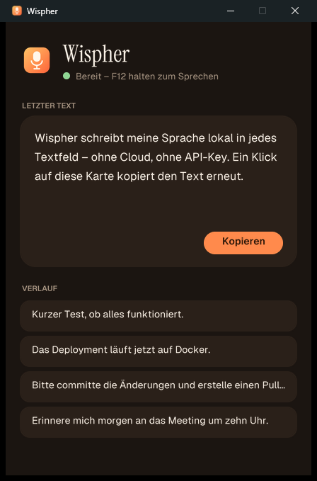

# Wispher — Local Push-to-Talk Speech-to-Text

**F12 halten → sprechen → loslassen → der Text steht im aktiven Feld.**
100 % lokal. Keine Cloud. Kein API-Key. Kein Mikrofon-Bit, das dein Büro verlässt.

Wispher ist ein Windows-Tool für Push-to-Talk-Diktat: faster-whisper läuft
lokal (CUDA oder CPU), aufgenommene Audio-Rohdaten landen nur temporär im
`%TEMP%` und werden nach der Transkription gelöscht — die Sprache verlässt
den Rechner zu keinem Zeitpunkt.

<p align="center"></p>

Wispher ist eine Windows-App mit Tray-Icon und kleinem Fenster. Das Fenster
zeigt den letzten Text und einen Verlauf — ein Klick kopiert den Text, falls er
nicht automatisch im Zielfeld gelandet ist.

```
 F12 (keyboard-Paket)        Wispher.exe (Python)                 Ziel-App
┌────────────────┐        ┌──────────────────────┐
│ halten = START │ ─────▶ │ AudioRecorder        │
│                │        │   ↓ WAV (nur %TEMP%) │
│                │        │ STTEngine            │
│                │        │   (faster-whisper,   │
│ loslassen=STOP │ ─────▶ │    CUDA/CPU-Fallback)│
│                │        │ TextProcessor        │
│                │        │   ↓                  │
│                │        │ TextInjector ── Ctrl+V ──▶  aktives Feld
└────────────────┘        └──────────────────────┘
                           Tray-Icon + Fenster (Klick = kopieren)
```

## Installation

**Voraussetzungen:** Python 3.10+, optional NVIDIA-GPU + CUDA (ohne GPU fällt
Wispher automatisch auf CPU zurück, `use_gpu` in der `config.yaml`).

```bash
pip install -r requirements.txt
python wispher_app.py    # aus dem Quellcode starten
build.bat                # baut dist\Wispher\Wispher.exe (ca. 3 GB mit CUDA-Libs)
```

Die EXE braucht den Ordner `_internal` und `config.yaml` daneben.
`make_icon.py` erzeugt das Icon in `assets/`.

**Benutzung:** `Wispher.exe` starten, F12 halten, sprechen, loslassen. Beenden
über das Tray-Icon (Rechtsklick → Beenden). Logs: `wispher.log` neben der EXE.

## Konfiguration (`config.yaml`)

| Schlüssel | Vorgabe | Bedeutung |
|---|---|---|
| `language` | `de` | Whisper-Sprache |
| `hotkey` | `F12` | Push-to-Talk-Taste |
| `initial_prompt` | – | Hilft bei Fachbegriffen und englischen Wörtern im Satz |
| `model` | `small` | faster-whisper-Modellgröße (`tiny` … `large-v3`) |
| `use_gpu` | `true` | CUDA nutzen, wenn verfügbar |
| `max_recording_seconds` | `60` | Fail-Safe gegen vergessene F12-Taste |
| `auto_paste` | `true` | Text per Ctrl+V einfügen (sonst nur Zwischenablage) |
| `beep_on_start` / `beep_on_end` | `false` | Audio-Feedback bei Aufnahmebeginn/-ende |

## Datenschutz

- Audio wird ausschließlich als temporäre WAV-Datei in `%TEMP%\stt`
  geschrieben und im `finally`-Block gelöscht — auch bei Fehlern.
- Transkription läuft vollständig offline über faster-whisper.
- Keine Telemetrie. Nur beim ersten Start lädt faster-whisper das Modell von Hugging Face herunter. Audio und Text verlassen den Rechner nie.

## Schriften

[Geist](https://github.com/vercel/geist-font) (Vercel) und [Instrument Serif](https://fonts.google.com/specimen/Instrument+Serif) (Google Fonts), beide unter der SIL Open Font License. Die Schriftdateien liegen in `assets/fonts/` und sind in die EXE gebündelt. Lizenztext: `assets/fonts/OFL-Geist.txt`.

## Lizenz

MIT — siehe [LICENSE](LICENSE).
