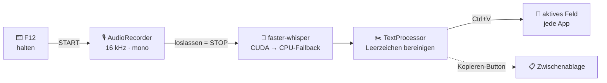
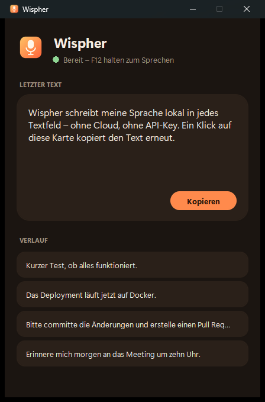

<p align="center"></p>

<p align="center">


<a href="LICENSE"></a>
</p>

<p align="center">
<a href="#schnellstart">Schnellstart</a> ·
<a href="#warum-wispher">Warum Wispher?</a> ·
<a href="#konfiguration-configyaml">Konfiguration</a> ·
<a href="#datenschutz">Datenschutz</a> ·
<a href="#fehlersuche">Fehlersuche</a>
</p>

# Wispher — Local Push-to-Talk Speech-to-Text

**F12 halten → sprechen → loslassen → der Text steht im aktiven Feld.**
100 % lokal. Keine Cloud. Kein API-Key. Kein Mikrofon-Bit, das dein Büro verlässt.

Wispher ist ein Windows-Tool für Push-to-Talk-Diktat. [faster-whisper](https://github.com/SYSTRAN/faster-whisper)
läuft lokal auf GPU (CUDA) oder CPU. Die Audio-Rohdaten liegen nur kurz im
`%TEMP%` und werden nach der Transkription gelöscht.

<p align="center"></p>

## So funktioniert's



Wispher läuft als Tray-Icon mit kleinem Fenster. Das Fenster zeigt den letzten
Text. Ein Klick auf **Kopieren** legt ihn in die Zwischenablage, falls er nicht
im Zielfeld gelandet ist.

<p align="center"></p>

## Schnellstart

**Voraussetzungen:** Windows 10/11, Python 3.10+, ein Mikrofon. Eine NVIDIA-GPU ist optional.

```powershell
git clone https://github.com/guschi18/wispher.git
cd wispher
python -m venv .venv ; .venv\Scriptsctivate
pip install -r requirements.txt
python wispher_app.py
```

1. **Warten**, bis der Status im Fenster auf „Bereit" springt. Beim ersten Start lädt faster-whisper das Modell (`large-v3` ≈ 3 GB) einmalig von Hugging Face.
2. **Cursor** in ein beliebiges Textfeld setzen.
3. **F12 halten**, sprechen, loslassen. Fertig.

Das Fenster schließen (X) schickt Wispher in den Tray. Beenden: Tray-Icon → Rechtsklick → **Beenden**.

### Mit NVIDIA-GPU (empfohlen, ca. 10× schneller)

```powershell
pip install nvidia-cublas-cu12 nvidia-cudnn-cu12
```

Ohne diese Pakete fällt Wispher automatisch auf die CPU zurück (siehe `wispher.log`). Mit CPU empfiehlt sich `model: small` und `use_gpu: false` in der `config.yaml`.

### Eigene EXE bauen

```powershell
build.bat    # → dist\Wispher\Wispher.exe (ca. 3 GB mit CUDA-Libs)
```

Die EXE braucht den Ordner `_internal` und die `config.yaml` daneben. `make_icon.py` erzeugt das Icon in `assets/`.

## Konfiguration (`config.yaml`)

| Schlüssel | Vorgabe | Bedeutung |
|---|---|---|
| `language` | `de` | Whisper-Sprache |
| `hotkey` | `F12` | Push-to-Talk-Taste |
| `initial_prompt` | – | Hilft bei Fachbegriffen und englischen Wörtern im Satz |
| `model` | `large-v3` | faster-whisper-Modellgröße (`tiny` … `large-v3`) |
| `use_gpu` | `true` | CUDA nutzen, wenn verfügbar |
| `max_recording_seconds` | `60` | Fail-Safe gegen vergessene F12-Taste |
| `auto_paste` | `true` | Text per Ctrl+V einfügen (sonst nur Zwischenablage) |
| `beep_on_start` / `beep_on_end` | `false` | Audio-Feedback bei Aufnahmebeginn/-ende |

## Datenschutz

- Audio wird ausschließlich als temporäre WAV-Datei in `%TEMP%\stt`
  geschrieben und im `finally`-Block gelöscht — auch bei Fehlern.
- Transkription läuft vollständig offline über faster-whisper.
- Keine Telemetrie. Nur beim ersten Start lädt faster-whisper das Modell von Hugging Face herunter. Audio und Text verlassen den Rechner nie.

## Schriften

[Geist](https://github.com/vercel/geist-font) (Vercel) und [Instrument Serif](https://fonts.google.com/specimen/Instrument+Serif) (Google Fonts), beide unter der SIL Open Font License. Die Schriftdateien liegen in `assets/fonts/` und sind in die EXE gebündelt. Lizenztext: `assets/fonts/OFL-Geist.txt`.

## Lizenz

MIT — siehe [LICENSE](LICENSE).
